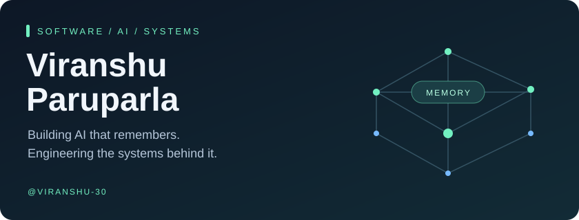
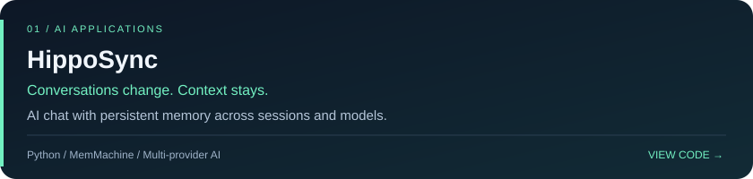
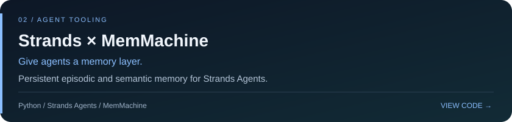
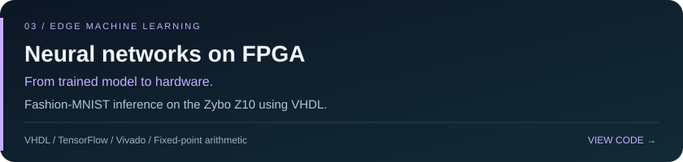

<!-- Profile assets are local: no external badge or statistics service is required. -->

  

  <a href="#about">About</a> &nbsp; · &nbsp;
  <a href="#selected-projects">Selected projects</a> &nbsp; · &nbsp;
  <a href="#toolbox">Toolbox</a> &nbsp; · &nbsp;
  <a href="https://github.com/Viranshu-30?tab=repositories">All repositories ↗</a>

## About

Hi, I'm **Viranshu**. My work spans AI applications, persistent memory for agents, and machine learning on embedded hardware. I'm interested in how models connect to useful software—and how the systems underneath make it work.

**Focus:** AI memory · Agent integrations · Software engineering · Edge ML

## Selected projects

<b>Explore HippoSync</b> — memory, models, and collaboration

An AI chat application that uses **MemMachine V2** to preserve context across conversations. Its documented features include OpenAI, Claude, and Gemini support, shared team projects, email verification, and Tavily web search.

- **Problem:** Conversation context needs to persist when sessions or models change.
- **Approach:** Keep persistent memory behind a multi-provider chat experience.
- **Explore:** [Features and setup](https://github.com/Viranshu-30/HippoSync#readme).

 

<b>Explore Strands × MemMachine</b> — tools for agents that remember

A Python extension connecting **Strands Agents** to **MemMachine**. The integration exposes tools to store, search, list, and delete memories, with separate project namespaces.

- **Memory types:** Episodic memories for interactions; semantic memories for structured facts.
- **Design:** Agents access persistent memory through a tool interface with metadata filtering.
- **Explore:** [Usage examples and supported actions](https://github.com/Viranshu-30/strands-memmachine#readme).

 

<b>Explore FPGA inference</b> — taking a model into hardware

A **Fashion-MNIST** classifier targeting the **Zybo Z10 FPGA**, with a TensorFlow training workflow and VHDL implementation.

- **Model:** 784 → 128 → 64 → 10 multilayer perceptron.
- **Hardware:** 8-bit fixed-point computation, BRAM storage, UART input, and display output.
- **Engineering focus:** Weight storage, pipelining, and clock-domain coordination.
- **Explore:** [Architecture and implementation](https://github.com/Viranshu-30/embedded-neural-network-deployment-on-fpga#readme).

## Toolbox

| Area | Technologies used in these projects |
| :--- | :--- |
| AI applications | Python · MemMachine · OpenAI · Claude · Gemini |
| Agent tooling | Strands Agents · Persistent memory · Metadata filtering |
| Machine learning & hardware | TensorFlow · VHDL · Vivado · FPGA |

---

  <b>Explore the code behind the projects.</b> 
  <a href="https://github.com/Viranshu-30?tab=repositories">Browse my repositories →</a>

