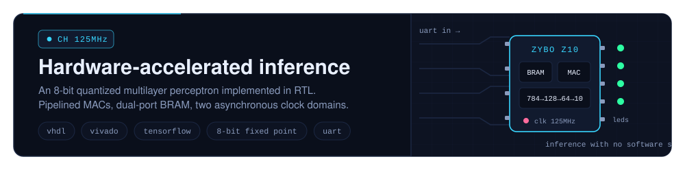
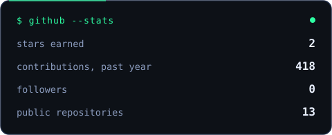
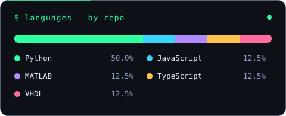
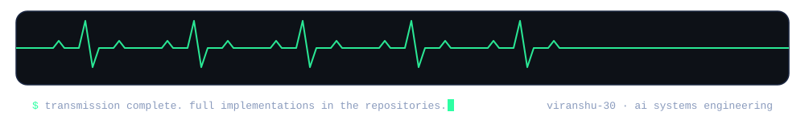

<a id="top"></a>
<p align="center">
  
</p>

<p align="center">
  <a href="#transmissions"></a>
  <a href="#telemetry"></a>
  <a href="#toolbox"></a>
  <a href="https://github.com/Viranshu-30?tab=repositories"></a>
  <a href="https://viranshu-30.github.io"></a>
</p>

I'm **Viranshu Paruparla**. I work at the intersection of machine learning and systems engineering: persistent memory architectures for AI agents, distributed optimization over physical communication channels, and neural inference compiled down to reconfigurable hardware. The recurring theme is intelligence that survives production constraints: bandwidth, latency, power, and time.

Five transmissions below, ordered by signal strength. Each one expands.

<a id="transmissions"></a>


<a href="https://github.com/Viranshu-30/strands-memmachine">
  
</a>

<details>
<summary>&nbsp;<b>channel PR #862</b> · the upstream contribution in detail</summary>
<br/>

[MemMachine](https://github.com/MemMachine/MemMachine) is an open source memory platform for AI agents (3.1k stars). I authored the integration that exposes it to [Strands Agents](https://strandsagents.com) as a native tool; the maintainers reviewed and merged it at milestone v0.3.7.

The interface reduces to four lines:

```python
from strands import Agent
from strands_memmachine import memmachine_memory

agent = Agent(tools=[memmachine_memory])
# the agent now holds durable, queryable memory
```

The tool surfaces episodic memory (event-level records of interaction), semantic memory (structured factual knowledge), retrieval and deletion, and isolated project namespaces that enforce strict memory separation between agents.

Contributing upstream is a different discipline from solo work: conforming to an external codebase's conventions, defending design decisions in review, and shipping to users who are not you.

**[The integration →](https://github.com/Viranshu-30/strands-memmachine)** · **[MemMachine →](https://github.com/MemMachine/MemMachine)**

</details>

<br/>

<a href="https://github.com/Viranshu-30/HippoSync">
  
</a>

<details>
<summary>&nbsp;<b>channel MEM.V2</b> · the architecture of persistent context</summary>
<br/>

Named for the hippocampus, the structure that consolidates memory. HippoSync decouples the memory layer from the model layer: conversational state persists in MemMachine V2 behind a provider-agnostic interface, so context established in one session under one provider is retrievable in any later session under any other.

Architecture highlights:

- Unified abstraction over OpenAI, Anthropic and Gemini
- Team workspaces with shared agent context across members
- Verified-email authentication with enforced password strength
- Tavily-backed retrieval for live web grounding

Python backend, web client, SQLite for application state, MemMachine for persistence.

**[Read the repo →](https://github.com/Viranshu-30/HippoSync)**

</details>

<br/>

<a href="https://github.com/Viranshu-30/distributed-cocoa-usrp">
  
</a>

<details>
<summary>&nbsp;<b>channel 915 MHz</b> · the physical layer of distributed training</summary>
<br/>

The distributed learning literature routinely abstracts the network into a simulated delay term. This platform removes the abstraction. Two compute nodes each hold a disjoint shard of the Covtype dataset and run local dual coordinate ascent (CoCoA); every aggregated weight update is serialized, framed, and transmitted to the peer over a USRP N210 software-defined radio at 915 MHz. No ethernet, no sockets, no simulation.

Each update is carried by a purpose-built framing protocol:

```
[ preamble | sender id | round # | payload length | Δw vector | adler-32 ]
```

Round-aware packet filtering guarantees that stale frames from earlier rounds are never applied to later optimization state.

| Measurement | Value |
| :--- | ---: |
| Training samples across both nodes | 581,008 |
| Features | 54 |
| Global communication rounds | 100 |
| Local iterations per round | 10,000 |
| Terminal weight divergence between nodes | ~4.13e-16 |
| Aggregate computation time | ~3.8 s |
| Aggregate communication time | ~1,985 s |

Computation accounted for seconds; the channel accounted for half an hour. That asymmetry is precisely the motivation behind gradient compression, local-update methods, and the broader communication-efficient training literature, measured here on physical hardware rather than assumed in simulation.

**[Read the repo →](https://github.com/Viranshu-30/distributed-cocoa-usrp)**

</details>

<br/>

<a href="https://github.com/Viranshu-30/embedded-neural-network-deployment-on-fpga">
  
</a>

<details>
<summary>&nbsp;<b>channel 125 MHz</b> · from trained weights to RTL</summary>
<br/>

The exercise: take a trained TensorFlow model and remove every layer of software beneath it. The result is a 784 → 128 → 64 → 10 multilayer perceptron implemented directly in VHDL, performing Fashion-MNIST classification on a Zybo Z10 FPGA with no operating system and no processor in the inference path.

| Constraint | Resolution in hardware |
| :--- | :--- |
| Floating point is prohibitively expensive | Quantization to 8-bit fixed point arithmetic |
| Parameter storage | Weights synthesized into BRAM via .coe initialization |
| Two asynchronous clock domains (125 MHz UART, 36 MHz compute) | Dual-port BRAM as the clock-domain crossing |
| Matrix multiplication throughput | Pipelined multiply-accumulate datapath |
| Result observability | Seven-segment classification readout, LED state-machine telemetry |

Quantization, memory layout, and data movement, decisions a framework normally makes on your behalf, are all explicit here. The project reframed how I evaluate inference cost, which is the substance of efficient AI.

**[Read the repo →](https://github.com/Viranshu-30/embedded-neural-network-deployment-on-fpga)**

</details>

<br/>

<a href="https://github.com/Viranshu-30/Supervised-Learning-Pipeline-for-Phishing-Website-Classification">
  
</a>

<details>
<summary>&nbsp;<b>channel SEC</b> · model selection under a false-negative constraint</summary>
<br/>

A supervised classification pipeline over 11,000 URLs and 30 engineered features, benchmarked across five model families and deployed as a Django application performing real-time URL classification.

| Model | Test accuracy | False negatives |
| :--- | ---: | ---: |
| CatBoost (1000 iterations) | 97.28% | 17 |
| Random Forest | 96.87% | 28 |
| LightGBM | 95.80% | 33 |
| SVM | 94.68% | 36 |

In this domain the governing metric is the false negative rate: an undetected phishing site is a compromised credential. CatBoost won on precisely that axis.

**[Read the repo →](https://github.com/Viranshu-30/Supervised-Learning-Pipeline-for-Phishing-Website-Classification)**

</details>

<a id="telemetry"></a>


<p align="center">
  
  
</p>

<p align="center">
  
</p>

<p align="center">
  
</p>

<a id="toolbox"></a>
### Toolbox

<p align="left">
  
  
  
  
  
  
  
  
  
  
  
  
  
  
</p>

```yaml
current_focus:
  building:   persistent memory architectures for agentic systems
  exploring:  the lower bound of inference cost under aggressive quantization
  reading:    the communication-efficient optimization literature
contact:      viranshu-30.github.io, or open an issue on any repository. I respond.
```

<a href="https://github.com/Viranshu-30?tab=repositories">
  
</a>
